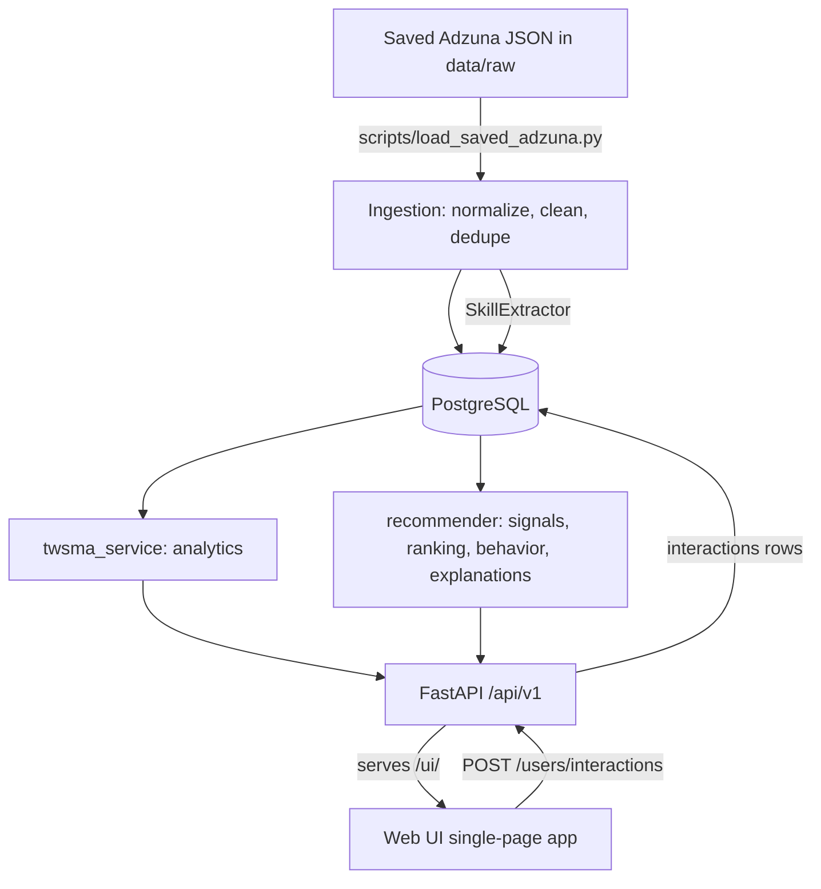

# JobIntel - System Architecture

See `docs/project_report.md` for the full methodology; this page is the component map.

## Components
- **`ingestion/`** - `JobNormalizer` (source schema -> `JobCreate`; missing fields stay missing), `TextCleaner`, `Deduplicator`, source clients, `saved_adzuna.py` (loads saved responses + extracts skills, writes an `ingestion_runs` audit row, idempotent).
- **`nlp/`** - `SkillExtractor` (taxonomy phrase matching), `EntityExtractor` (degrees, experience years), `JobRoleClassifier` (single source of truth for role categories).
- **`backend/app/services/twsma_service.py`** - pure analytics over `JobRecord`s (top skills, skills by role/location, distributions, co-occurrence, text statistics, date coverage); used by the API, scripts and tests.
- **`recommender/`** - `signals` (skill, role, location, TF-IDF content, recency), `behavior` (interaction-learned preference), `ranking` (weighted combination, missing-data rules, personalization mode), `config` (validated weights/strategies), `explainability`, `pipeline` (DB adapter), `evaluation` (offline proxy evaluation). `popularity.py`, `skill_matcher.py`, `content_based.py`, `hybrid.py` are thin wrappers over the same pipeline.
- **`backend/app/`** - FastAPI routers (thin), services, Pydantic schemas, SQLAlchemy models. PostgreSQL via `DATABASE_URL`; tests use in-memory SQLite.
- **`web/`** - single-page web UI (HTML/CSS/JS) served by the API at `/ui/`; no business logic.
- **Accounts** - `backend/app/core/security.py` (scrypt password hashes, signed expiring sessions, login throttling) and `endpoints/auth.py`.

## Key rules enforced in code
1. Real data only; missing data stays missing and is never rewarded in ranking.
2. One role classifier; one ranking implementation shared by every strategy and the evaluation.
3. Behavior is learned only from stored real interactions and is reported as `interaction_informed` only when it was actually used.
4. The UI never recomputes analytics or rankings.
