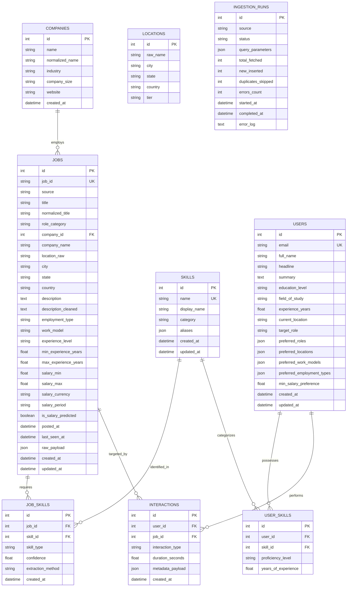

# JobIntel - Database Schema Specification

The JobIntel platform uses a normalized relational schema on **PostgreSQL** (SQLite is used only by the automated tests; the application never falls back to it silently). No schema change was made in the final phases: `interactions` already held everything needed for behavioral personalization.

## Entity Relationship Diagram

